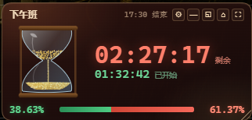
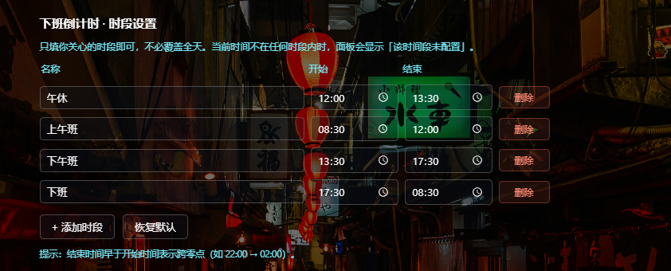

<div align="center">


# DSH 倒计时 · DSH Countdown

**在 DSH 的任意页面，看着时间从沙漏里漏走。**

[](https://github.com/deepseek-ai)
[](LICENSE)

</div>

<div align="center">
  
  <br/>
  
</div>

---

## 这是什么

一个常驻 DSH 界面的**工作时段倒计时**。它不是简单的数字倒数 —— 左边是一个**会漏沙的沙漏**，沙量严格按真实时间比例减少：上班越久，上球越空、下球越满。

**和普通倒计时插件的区别：**

- 沙漏的沙体积**按几何精确计算**（球体积分 + 二分求液面），不是"看着差不多"
- 沙面每一次移动都是真实时间的映射，误差 < 0.001%
- 流动感由 CSS 动画驱动，**不占 CPU**

---

## 功能

### ⏳ 沙漏倒计时

- 上球沙粒持续漏向下球，落点堆起**圆锥形沙丘**
- 沙流从细颈一路垂到沙堆顶，不悬空
- 沙子总量 = 半个球，上班时上球满、下班时下球满

### 🕐 四段独立计时

工作时段由你配置，**每段独立计算**：

```
上午班  08:30 → 12:00
午休    12:00 → 13:30
下午班  13:30 → 17:30
```

- 每段都有自己的进度、正计时、倒计时
- 跨段时全部归零重来
- **不要求覆盖全天** —— 只填你关心的时段

### 🟩🟥 进度线

底部一条线，左侧绿色 = 已过百分比，右侧红色 = 剩余百分比，两端都标两位小数。

### 📍 随意摆放

- 默认停在**右侧居中**
- 可拖动、可缩放（右下角手柄 / `Ctrl + 滚轮`）
- 一键全屏放大、恢复默认大小、回到默认位置
- 位置和尺寸自动记忆

### ⚙️ 配置就在插件页

点面板上的齿轮按钮，直接跳到本插件的配置页：

```
插件 → DSH 倒计时 → 时段设置
```

增删时段、改名称与时间，**改完立刻生效，不用刷新**。

---

## 安装

### 方式一：从 GitHub 直接安装（推荐，无需 npm）

```bash
dsh plugin --profile web add github:HelmsmanOfDesire/dsh-countdown
```

> 桌面版：`设置 → 插件 → 添加插件`，粘贴仓库地址。

### 方式二：从插件市场安装

在 DSH 的 **插件 → 发现** 里搜索「下班倒计时」，或直接从市场页安装。

---

## 使用

装好后，面板会自动出现在**任意页面**的右侧。默认时段是：

| 时段 | 时间 |
|---|---|
| 上午班 | 08:30 → 12:00 |
| 午休 | 12:00 → 13:30 |
| 下午班 | 13:30 → 17:30 |
| 下班 | 17:30 → 次日 08:30（跨零点） |

默认四段覆盖全天，可随意增删改；删掉某段时间，那段时间面板就会显示「该时间段未配置」。

**改时段**：点面板齿轮 → 编辑表格 → 改完自动保存。

**当前时间不在任何时段内**时，面板显示「该时间段未配置」——这是正常行为，不是故障。

---

## 配置说明

| 操作 | 说明 |
|---|---|
| **修改名称** | 直接在输入框里改 |
| **修改时间** | 用时间选择器，5 分钟步进 |
| **跨零点时段** | 结束时间**早于**开始时间即可，例如 `22:00 → 02:00` |
| **添加时段** | 新段自动接在最后一段之后，默认 1 小时 |
| **删除时段** | 至少保留一个，删掉的时间段变成"未配置" |
| **恢复默认** | 一键回到上面的三段默认配置 |

**时段重叠**会显示黄色提示（不阻止），面板优先显示排序靠前的那一段。

---

## 常见问题

**问：为什么收起后没有设置按钮？**
答：收起态只有 30px 高，放两个按钮会把进度条挤没。展开后才有齿轮按钮。

**问：为什么沙漏看起来变化很慢？**
答：这是真实的。4 小时的时段，沙面每分钟只移动约 0.4%，每秒的变化不足一个像素。但它是**真的在动**。

**问：DSH 升级后插件失效怎么办？**
答：本插件依赖 DSH 的 `shell.overlay` 和 `plugins.bundle.config` 插槽。如果 DSH 大版本升级导致失效，请提 issue。

**问：会拖慢 DSH 吗？**
答：不会。心跳 1 秒一次，标签页隐藏时自动停表，沙粒几何预计算并有缓存，实测 CPU 占用极低。

**问：支持周末吗？**
答：不区分。时段每天循环，周六日照常计时。如果你周末不上班，把时段删掉即可（会显示"未配置"）。

---

## 卸载

```bash
dsh plugin --profile web remove @HelmsmanOfDesire/dsh-countdown
```

或：**设置 → 插件 → DSH 倒计时 → 卸载**

---

## 开发

```bash
git clone https://github.com/HelmsmanOfDesire/dsh-countdown.git
cd dsh-countdown
```

改 `client.js` 后：

- 网页版：刷新页面（`Ctrl + R`）
- 桌面版：**重启 DSH**

---

## 许可

[MIT](LICENSE)

图标与设计为作者原创，随本仓库以 MIT 协议开源。
